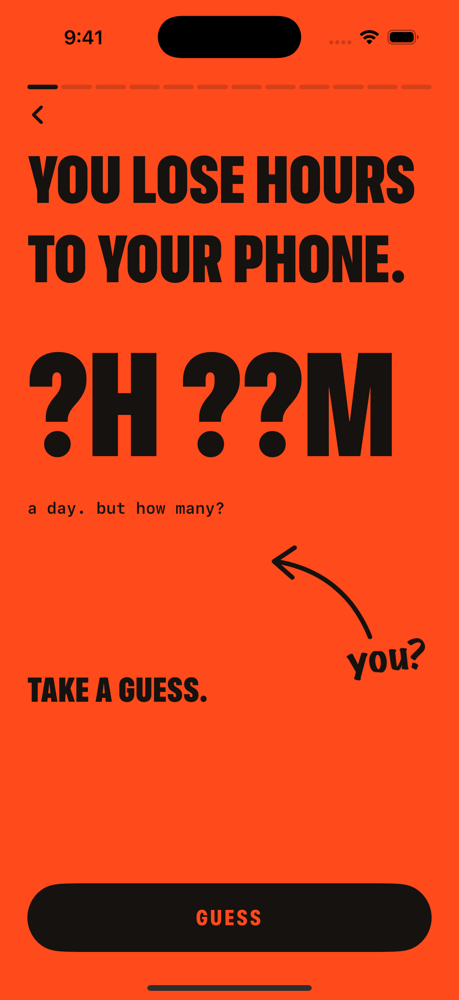
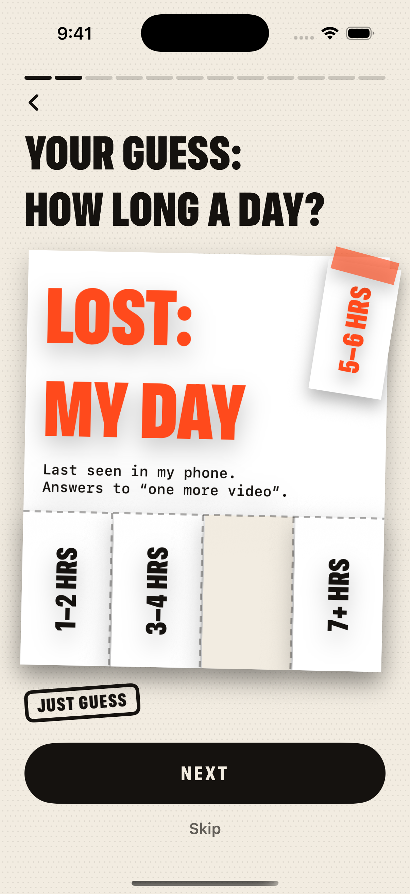
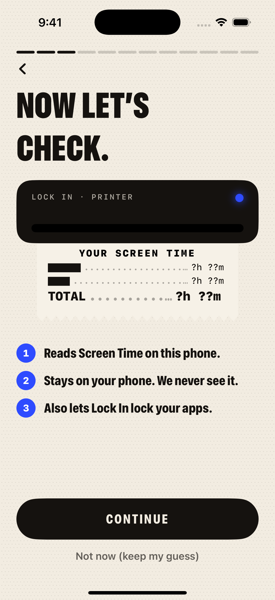
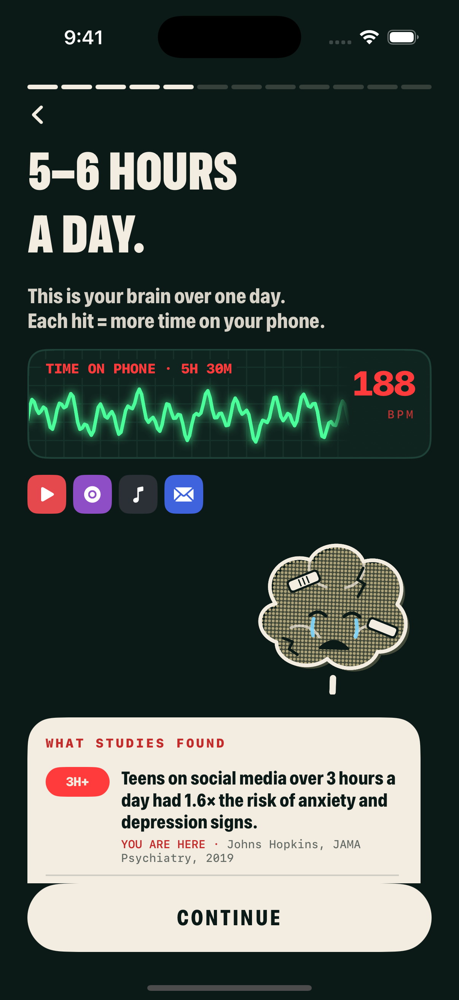
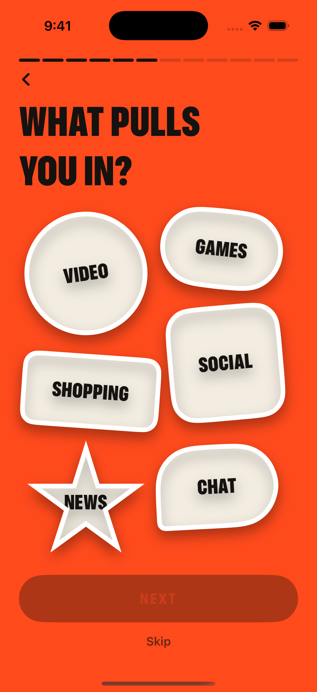
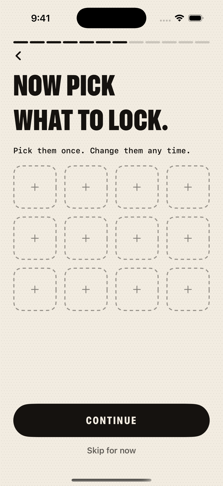
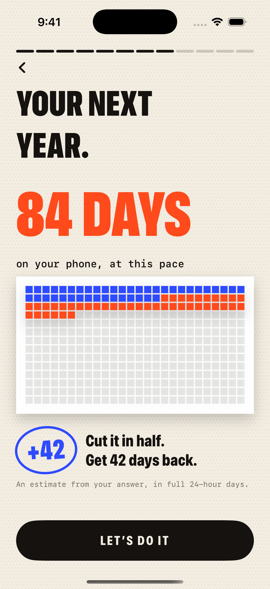
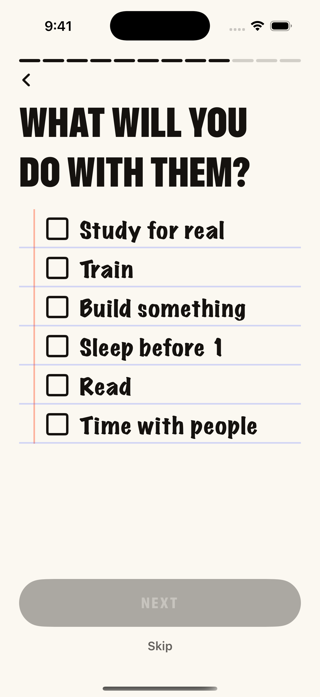
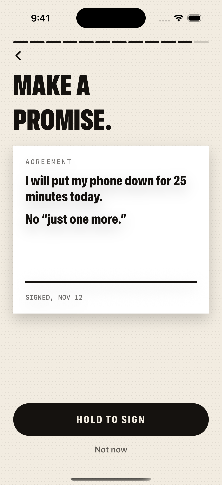
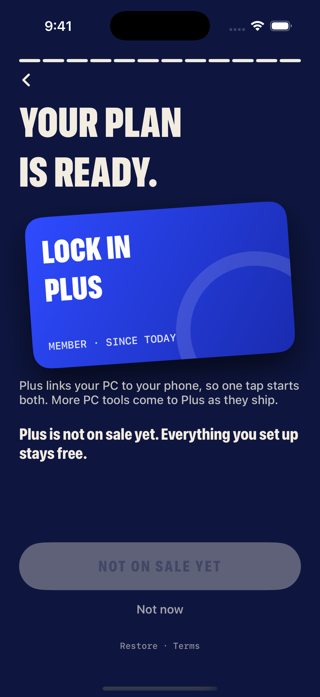

# Lock In — onboarding words (all 12 slides)

Pulled from the app code on 2026-11-12 (build 28). Every word the user sees, in order.
Pictures: simulator screenshots, iPhone 16. All slides in one file: `ONBOARDING_SLIDES.pdf`.

## Prompt you can paste to the other AI

> I'm building **Lock In**, an iPhone app that locks distracting apps for a timed focus session
> (Screen Time based). Below is every word on my 12 first-run slides. Rewrite them to be punchier,
> clearer and more persuasive, for teens and young adults who know they doomscroll.
>
> Rules:
> - Keep the meaning and the order of the slides. Keep the button jobs the same.
> - Headlines are huge, condensed, ALL CAPS, at most 2 lines of about 12 characters each.
> - Buttons: 1 to 3 words, ALL CAPS. Body lines: one short sentence each.
> - No shame, no medical claims. The study facts on slide 5 must stay true to the source.
> - Give me 2 versions of each slide: one bold, one calm.

## How the screens work (so the rewrite fits)
- Each slide is a different "printed" object: a poster, a lost-pet flyer, a receipt, stickers, a notebook, a contract, a member card.
- `{x}` is filled in by the app. `/` means "one of these, depending on the user".
- Slides 4 and 5 change with the user's hours. Slide 4 only shows if Screen Time access is on.

---

### 1. Hook (orange poster)

- Headline: **YOU LOSE HOURS TO YOUR PHONE.**
- Big number: **?H ??M**
- Line: a day. but how many?
- Handwritten note with arrow: you?
- Bottom line: **TAKE A GUESS.**
- Button: **GUESS**

### 2. Your guess (lost-pet flyer with tear-off tabs)

- Headline: **YOUR GUESS: HOW LONG A DAY?**
- Flyer: **LOST: MY DAY**
- Flyer text: Last seen in my phone. Answers to "one more video".
- Tear-off tabs: 1–2 HRS / 3–4 HRS / 5–6 HRS / 7+ HRS
- Stamp: JUST GUESS
- Button: **NEXT** · Link: Skip

### 3. Now let's check (receipt printer, asks for Screen Time access)

- Headline: **NOW LET'S CHECK.**
- Printer label: LOCK IN · PRINTER
- Blank receipt: YOUR SCREEN TIME · ██████ ?h ??m · ████ ?h ??m · TOTAL ?h ??m
- Numbered list:
  1. Reads Screen Time on this phone.
  2. Stays on your phone. We never see it.
  3. Also lets Lock In lock your apps.
- If already allowed, stamp: SCREEN TIME IS ALREADY ON
- If turned off: Screen Time is off for Lock In. iPhone only asks once, so turn it on in Settings > Screen Time > Apps with Screen Time Access.
- Button: **CONTINUE** / **NEXT** / **OPEN SETTINGS** · Link: Not now (keep my guess)

### 4. Real hours (Apple draws the real numbers; only with Screen Time on)
_No picture: Apple only draws this slide on a real phone._

- Reaction headline: **Oh wow.** / **Not bad.** / **Spot on.**
- YOU GUESSED {band} (crossed out), then the real number
- Line: a day, on average this week
- Line: **THAT'S {n} DAYS A YEAR.**
- Receipt: YOUR RECEIPT · THIS WEEK · PER DAY · top apps · PICKUPS ×{n}
- Stamp: THAT'S A LOT / NOT BAD
- No data: **NO HISTORY YET.** This iPhone has no Screen Time history for this week. We'll use your guess for now.
- Under it: Tap the one that matches: (1–2 HRS / 3–4 HRS / 5–6 HRS / 7+ HRS)
- Button: **NEXT**

### 5. Your brain over one day (heart monitor + cartoon brain + study card)

- Headline: **{1–2 / 3–4 / 5–6 / 7+} HOURS A DAY.**
- Line: This is your brain over one day. Each hit = more time on your phone.
- Monitor: TIME ON PHONE · {5H 30M} · {188} BPM
- Brain thought bubbles as hours climb: just 1 more… / ok, 1 more… / 12 more minutes… / no more brain rot plsss…
- Hit sounds: BONK! / POW! / WHAM! / SMACK! / K.O.
- Brain status: Your brain feels fine. / Your brain is tired. / Your brain is dizzy. / Your brain is fading. / Your brain is begging. / Your brain is gone.
- Low hours: Well done. Keep it like that. · bubble: I feel great!
- Study card header: WHAT STUDIES FOUND (or GOOD NEWS · WHAT STUDIES FOUND for low hours). One finding is marked YOU ARE HERE.
  - 30 MIN: Students who cut social media to 30 min a day felt less lonely and less depressed in 3 weeks. (U. of Pennsylvania, 2018)
  - 1–2H: Up to about 2 hours a day was not linked to harm in 120,000 teens. (Oxford, Psychological Science, 2017)
  - 3H+: Teens on social media over 3 hours a day had 1.6× the risk of anxiety and depression signs. (Johns Hopkins, JAMA Psychiatry, 2019)
  - 6H+: Over 6 hours a day, that risk went up to 1.8×. (Johns Hopkins, JAMA Psychiatry, 2019)
  - 7H+: Teens on screens 7+ hours a day were over 2× as likely to be diagnosed with depression or anxiety. (Twenge & Campbell, 2018)
  - SLEEP: More screen time meant worse sleep in 9 of 10 studies. (Sleep Medicine Reviews, 2015)
- Footnote: Studies show links, not proof. Not medical advice.
- Button: **CONTINUE**

### 6. What pulls you in (orange, sticker shapes)

- Headline: **WHAT PULLS YOU IN?**
- Stickers: VIDEO · GAMES · SOCIAL · SHOPPING · NEWS · CHAT
- Button: **NEXT** · Link: Skip

### 7. Pick what to lock (Apple's app picker)

- Headline: **NOW PICK WHAT TO LOCK.** / after picking: **LOCKED.**
- Line: Pick them once. Change them any time. / They lock when your timer runs.
- Button: **CHOOSE APPS** / **CONTINUE** / **OPEN SETTINGS** / **LOOKS RIGHT**
- Link: Skip for now / Change apps

### 8. Your next year (grid of days)

- Headline: **YOUR NEXT YEAR.**
- Big number: **{84} DAYS**
- Line: on your phone, at this pace
- Circle: +{42} · Cut it in half. Get {42} days back.
- Footnote: An estimate from your answer, in full 24-hour days.
- Button: **LET'S DO IT**

### 9. What will you do with them (notebook checklist)

- Headline: **WHAT WILL YOU DO WITH THEM?**
- Checkboxes: Study for real · Train · Build something · Sleep before 1 · Read · Time with people
- Button: **NEXT** · Link: Skip

### 10. Making your plan (dark, receipt prints line by line, moves on by itself)

- Headline: **MAKING YOUR PLAN.**
- Receipt: PLAN FOR: YOU · ✓ {5–6 HRS} A DAY · ✓ {VIDEO + SOCIAL} · ✓ GOAL: {READ, STUDY} · ▌ DAILY LOCK: 25 MIN

### 11. Make a promise (contract, hold to sign)

- Headline: **MAKE A PROMISE.**
- Contract: AGREEMENT · I will put my phone down for **25 minutes** today. · No "just one more."
- Signature line: SIGNED, {NOV 12}
- Button: **HOLD TO SIGN** → KEEP HOLDING → SIGNED · Link: Not now

### 12. Your plan is ready (navy, Plus member card)

- Headline: **YOUR PLAN IS READY.**
- Card: LOCK IN PLUS · MEMBER · SINCE TODAY
- Line: Plus links your PC to your phone, so one tap starts both. More PC tools come to Plus as they ship.
- With a free trial, timeline: Today: Everything unlocked. $0. · Day {5}: We remind you. · Day {7}: {price}. Cancel any time.
- Fine print: Free for {7} days, then {price}. Renews automatically until you cancel in Settings.
- Not on sale yet: Plus is not on sale yet. Everything you set up stays free.
- Button: **TRY FOR $0** / **GET PLUS** / **NOT ON SALE YET** · Link: Not now · Restore · Terms · Privacy
